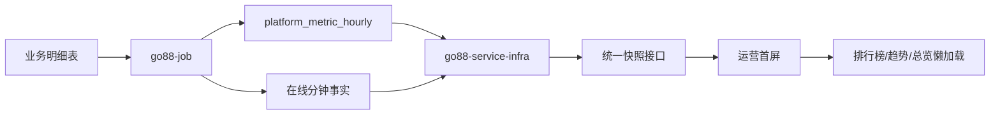

# GO88 运营后台与首屏看板交接文档

> 最后更新：2026-10-29
> 最近前端重启验证：2026-10-29
> 前端工作区：`D:\work\project\go88\go88-plus-ui`
> 后端工作区：`D:\work\project\go88\go88_cloud_plus_2.6.2`

## 接手前必读

- 本仓库是 GO88 运营后台前端，技术栈为 Vue 3、TypeScript、Element Plus、Vite。
- 本次工作的核心是运营首屏看板，不包含充值、提现、投注等业务链路本身的重写。
- 财务侧确认：充值退款和拒付理论上不存在，因此系统不设计退款事实、净充值或拒付扣减链路。
- 金额不做任何倍率换算，数据库返回什么就展示什么；页面不显示小数。
- 今日 NGR 暂不可用，只有今日 GGR。不要将 GGR 当净利润使用。
- 当前实现按单主站点设计。事实表没有 `site_id`，多站点物理隔离尚未完成。
- 后端工作区存在其他 Slot/测试相关未提交修改，不属于本看板任务，接手时不要回滚或混入本次变更。
- `dev-ui.err` 等开发日志可能包含 Authorization 请求头，禁止提交、外发或写入正式报告。

## 快速启动

### 前端

```powershell
cd D:\work\project\go88\go88-plus-ui
pnpm install --frozen-lockfile
pnpm dev
```

默认访问 `http://localhost:81/`。如果 80 端口被 nginx 占用，Vite 会自动选择 81。

生产构建：

```powershell
pnpm build
```

静态检查：

```powershell
pnpm exec oxlint src
```

### 后端

先停止正在运行的 `go88-job` 和 `go88-service-infra`，否则 Windows 会锁定 JAR，Spring Boot 重打包会失败。

```powershell
cd D:\work\project\go88\go88_cloud_plus_2.6.2
mvn -P wy -pl go88-modules/go88-service-infra,go88-modules/go88-job `
  -am package -DskipTests
```

本地服务端口：

| 服务                 | HTTP | RPC/gRPC |
| -------------------- | ---: | -------: |
| Vite 前端            |   81 |        - |
| `go88-service-infra` | 9202 |    20881 |
| `go88-job`           | 9209 |    17890 |

启动 Infra 时需要配置本地 Nacos 地址和 namespace；启动 Job 后应检查 SnailJob 和 Nacos 是否连接成功。Infra 尚未注册时，Job 可能短暂出现 Dubbo `No provider available`，Infra 就绪后通常恢复。

## 项目概览



首屏入口：`src/views/index.vue`

快照接口：

```text
GET /infra/report/dashboard/snapshot?site=...
```

首屏不再分别轮询 KPI、实时资金、在线和风控，而是一次获取：

```text
meta      站点、币种、金额、统计时区、快照时间
kpi       首屏经营指标
realtime  在线、充值、提现申请、待处理提现、成功出款
risk      风控数量和风险金额
health    数据源健康度
alerts    待处理资金、提现风险、数据断链、时区不一致
```

## 业务口径

| 指标             | 最终口径                                                 |
| ---------------- | -------------------------------------------------------- |
| 充值金额         | `payment_order.type=1 AND status=2` 的 `arrive_amount`   |
| 提现申请额       | 按 `user_withdraw_order.apply_at` 统计，覆盖全部申请状态 |
| 待处理提现       | `status=0/1`，展示金额、单数、最长等待时间               |
| 成功出款         | `status=2`，按 `finish_at` 统计                          |
| 驳回/取消        | 按 `finish_at` 独立统计，不混入成功出款                  |
| 有效投注         | 投注金额按 `game_valid_bet_ratio.ratio_percent` 折算     |
| 今日 GGR         | 投注金额减玩家游戏入账                                   |
| 今日 NGR         | 暂不计算，等待活动奖励、支付成本、代理佣金和税费数据完整 |
| 在线玩家         | 分钟事实中的去重真人用户                                 |
| 登录失败 IP/设备 | 日级去重，不再累加小时去重值                             |
| 高风险用户       | 风控事件与新增封禁的日级去重并集                         |
| 金额展示         | 原值展示、整数千分位、不缩放、不显示小数                 |

## 运营指挥台首屏口径

| 展示项     | 最终口径                                                   |
| ---------- | ---------------------------------------------------------- |
| 活跃玩家   | 今日登录/在线、游戏或资金行为去重真人                      |
| 付费玩家   | 今日成功充值去重用户 / 今日活跃玩家                        |
| 付费率     | 今日成功充值去重用户 ÷ 今日活跃玩家                        |
| 充值成功   | `payment_order.type=1 AND status=2` 的到账金额             |
| 提现待处理 | `user_withdraw_order.status IN (0,1)`，展示“单数 / 金额”   |
| 提现超时   | 待处理提现中 `apply_at <= now-5分钟` 的单数                |
| 支付异常   | 今日创建且 `payment_order.type=1 AND status=3` 的充值单数  |
| 高风险提现 | 当前待处理且 `risk_flag > 0` 的单数和金额                  |
| 有效投注   | 按游戏有效投注配置比例折算                                 |
| GGR        | 投注金额减玩家游戏入账，不含活动、支付成本、代理佣金和税费 |
| RTP        | 派彩金额 ÷ 投注金额 × 100%                                 |
| 复充       | 同一用户今日成功充值次数达到 2 次及以上                    |

首屏通过统一快照的 `commandCenter` 返回以下视图模型：

```text
trend24h    在线、投注、充值、提现、风险 24 小时序列
actions     支付异常、提现超时、高风险提现、数据断链
funds       充值 → 投注 → 派彩 → 提现
games       投注额 Top 游戏及厂商、GGR、RTP
quality     新增 → 活跃 → 付费 → 复充
```

## 数据来源

| 页面数据             | 数据来源                                                             |
| -------------------- | -------------------------------------------------------------------- |
| 今日 KPI             | 已完成小时读 `platform_metric_hourly`，当前小时补查明细              |
| 在线                 | `platform_online_user_minute`、`platform_online_conn_minute`         |
| 充值                 | `payment_order`                                                      |
| 提现                 | `user_withdraw_order`                                                |
| 投注、派彩、有效投注 | `user_wallet_ledger` + `game_valid_bet_ratio`                        |
| 新增会员             | `player_account`                                                     |
| 历史资金趋势         | `user_finance_daily_summary`                                         |
| 历史游戏趋势         | `user_game_daily_summary`                                            |
| 历史活跃趋势         | `user_activity_daily`                                                |
| 风控                 | `platform_metric_hourly`，上游为登录、封禁、风控事件、提现风险等事实 |
| 健康度               | 各分钟、小时、日事实表最后写入时间                                   |
| 24 小时趋势          | `platform_metric_hourly` + 在线分钟事实；当前小时补查明细            |
| 游戏健康             | `user_wallet_ledger` + `game_catalog` + `game_platform`              |

在线分钟事实天然有约 2 分钟延迟。前端虽然每 30 秒请求快照，不代表在线数据每 30 秒产生新值。

## 已完成并解决的问题

| 问题                                   | 解决方式                                                | 关键证据                                                                 |
| -------------------------------------- | ------------------------------------------------------- | ------------------------------------------------------------------------ |
| 首屏请求分散、轮询压力大               | 新增统一快照接口；按组件 TTL 缓存；前端只拉一个首屏接口 | `DashboardSnapshotService.java`、`src/api/report/dashboard/index.ts`     |
| 页面隐藏后仍持续轮询                   | 页面隐藏时暂停，恢复可见时刷新；增加请求单飞控制        | `src/views/index.vue`                                                    |
| 提现按完成时间统计，和申请口径不一致   | 拆分提现申请、待处理、成功出款；申请按 `apply_at`       | `DashboardAggregateReader.java`、`DashboardRealtimeService.java`         |
| “今日损益”实际只等于投注减派彩         | 改名为“今日GGR”；NGR 未就绪时不伪造                     | `DashboardKpiService.java`、`DashboardSnapshotService.java`              |
| 有效投注直接等于投注额                 | 按 `game_valid_bet_ratio` 折算并补充到小时、KPI、趋势   | `DashboardAggregateReader.java`、`PlatformMetricHourlyMapper.java`       |
| 风控小时去重值被直接累加               | 改为按自然日重新去重 IP、设备和高风险用户               | `DashboardRiskService.java`、`DashboardAggregateReader.java`             |
| 在线页面显示请求时间，而非真实采样时间 | 返回最后一条分钟事实时间                                | `DashboardRealtimeService.java`                                          |
| 金额错误地除以 100                     | 取消缩放；后端 `amountScale=1`，前端原值展示            | `DashboardSiteSetting.java`、`src/views/index.vue`                       |
| 金额显示小数                           | 统一整数千分位，趋势值也在展示层取整                    | `src/views/index.vue`、`TrendChart.vue`                                  |
| 数据断链无法区分业务为零               | 快照加入健康度、异常源和告警                            | `DashboardHealthService.java`、首屏健康状态条                            |
| 指标颜色语义错误                       | 按指标方向判断好坏，不再统一上涨红色                    | `src/views/index.vue`                                                    |
| 排行榜用户名和 UID 被前端遮罩          | 运营态不再遮罩，完整展示用户名和 UID                    | `src/views/index.vue`                                                    |
| 业务列与统计默认收起                   | 设备列、投注累计、流水统计和系统编号列默认全部展示      | `src/views/member`、`src/views/system`                                   |
| 流水列表只能按 UID 定位会员            | 新增“用户名/昵称”模糊查询，列表与统计共用条件           | `member/ledger/index.vue`、`MemberLedgerServiceImpl.java`                |
| 会员详情只显示掩码且需手动查看明文     | 有 `member:detail:plain` 权限时自动展示完整手机号和邮箱 | `src/views/member/detail/index.vue`                                      |
| 工作流人员名称最多显示三行             | 取消行数截断，默认展示完整人员名称                      | `src/components/Process/UserNameDisplay.vue`                             |
| 密码、Token 与客户端密钥可能被误放开   | 继续仅对业务数据全展，凭证类字段保留打码和安全查看控制  | `src/views/system/client/index.vue`、`src/views/member/anchor/index.vue` |
| 首页仍是纵向经营报表，不是一屏指挥台   | 重构为 KPI、24 小时趋势、立即处理、资金/游戏/用户三栏   | `src/views/index.vue`、`CommandTrendChart.vue`                           |
| 首页缺少支付异常、提现超时、游戏 RTP   | 统一快照新增 `commandCenter` 视图模型                   | `DashboardCommandService.java`、`DashboardSnapshotService.java`          |
| 付费、RTP、复充口径不明确              | 固化已确认口径并写入 SQL 与专项测试                     | `DashboardAggregateReaderTest.java`、`DashboardCommandServiceTest.java`  |
| 排行、历史趋势首屏加载过多             | 通过 IntersectionObserver 按区块懒加载                  | `src/views/index.vue`                                                    |
| 站点时区可能和任务时区不一致           | 快照返回站点/全局时区，不一致时告警                     | `DashboardSnapshotService.java`                                          |
| 多实例共享缓存尚未实现                 | 当前采用单实例内存缓存，降低单实例查询压力              | `DashboardSnapshotService.java`                                          |
| 认证失败后仍停留后台或弹出确认框       | 立即清理本地登录态并跳转登录页；不显示提示、不等待      | `src/utils/request.ts`、`src/store/modules/user.ts`、`src/permission.ts` |

## 证据到交接路径

| Evidence                                                        | Finding                                  | Handoff path                                     |
| --------------------------------------------------------------- | ---------------------------------------- | ------------------------------------------------ |
| `src/views/index.vue` 使用 `getDashboardSnapshot`，旧接口仍保留 | 首屏已经切换快照，但旧接口用于兼容和灰度 | 后续确认稳定后再决定是否下线旧接口               |
| `DashboardSnapshotService.java` 使用内存 `ConcurrentHashMap`    | 缓存只覆盖单实例                         | 多实例部署前迁移到 Redis 或统一快照事实          |
| `DashboardSnapshotService.java` 的 NGR 项固定为 `null`          | 成本和税费数据未齐                       | 接入活动奖励、支付成本、代理佣金、税费后再启用   |
| `DashboardSiteSetting.java` 的 `amountScale=1`                  | 金额原值展示                             | 不要重新引入 `/100` 或币种倍率换算               |
| `DashboardRiskService.java` 直接查日级去重                      | 风控去重更慢但更准确                     | 上线前检查查询计划并观察数据库压力               |
| `DashboardAggregateReader.java` 使用统一钱包游戏条件            | 实时与小时口径更一致                     | 仍需用真实业务日与财务、游戏报表逐项对账         |
| 后端有 12 个与本看板无关的未提交文件                            | 工作区存在其他 Slot/测试任务             | 接手时必须按文件审查，禁止整体回滚或混入本次提交 |
| `dev-ui.err` 包含开发请求日志风险                               | 日志可能携带 Authorization               | 不上传、不提交、不作为交接附件                   |

## 验证结果

最近一次本地验证：

- 前端 `pnpm build` 通过。
- 本任务改动文件 `oxlint` 通过。
- 后端看板专项测试通过：`DashboardAggregateReaderTest`、`DashboardCommandServiceTest`、
  `DashboardSnapshotServiceTest`，共 11 个测试，0 失败。
- `go88-service-infra` 可执行 JAR 打包通过。
- 全量 `oxlint src` 仍被 `src/views/game/lottery/components/PlayConfigPanel.vue` 的 2 个既有错误阻断：
  `tierNote` 重复键和自赋值；该文件不属于本次修改。
- `vue-tsc --noEmit` 仍存在仓库既有类型错误，本次修改文件未出现在错误列表中；不能宣称全量类型检查通过。
- 2026-10-29 11:01 已重启 Vite，`http://localhost/` 返回 HTTP 200；当日启动时后端 9201、9202、9310 未运行，
  依赖后端接口的浏览器端回归未完成。
- 2026-10-29 尝试重启 Infra 时，本机 Nacos `127.0.0.1:8848/9848` 未运行，服务无法完成注册和配置加载；
  半启动进程已停止，未虚报后端运行成功。
- 后端 `go88-job`、`go88-service-infra` 编译和打包通过。
- 前端页面返回 HTTP 200。
- Infra HTTP `9202` 与 Job HTTP `9209` 均已启动；未携带登录令牌时返回 401，说明鉴权链路生效。
- 2026-10-26 已完成本地重启验证；2026-10-29 整理文档时未重新启动全部依赖服务。

## 未完成事项与交接清单

### P0：上线前必须完成

1. **用真实业务日对账**
   - 对比看板与权威明细：充值、提现申请、待处理提现、成功出款、投注、派彩、GGR、有效投注。
   - 验收标准：同口径、同时间窗口下金额和计数一致；T+1 终值无差异。

2. **执行 SQL 计划检查**
   - 对新增的钱包聚合、提现待处理、日级风控去重运行 `EXPLAIN`。
   - 验收标准：不存在意外的全表扫描；数据库 CPU、慢查询和扫描行数可接受。

3. **生产并发压测**
   - 模拟多个运营同时打开首屏，验证快照缓存、ETag、30 秒轮询和隐藏页暂停。
   - 验收标准：数据库查询不随页面数量线性增长，接口延迟满足运营使用要求。

4. **日志安全清理**
   - 检查 `dev-ui.err`、`dev-ui.out` 是否包含令牌或敏感请求头。
   - 验收标准：敏感日志不进入 Git、构建包或交接材料。

### P1：下一阶段业务完善

1. **启用 NGR**
   - 数据依赖：活动奖励、支付成本、代理佣金、税费。
   - 验收标准：GGR 与 NGR 同时展示，定义、来源、T+1 结算时间一致。

2. **联动处理入口**
   - 当前告警以展示为主，缺少跳转到提现队列、风险单、支付单的深链。
   - 验收标准：待处理提现、提现风险和断链告警可以一键进入对应处理页。

3. **分布式缓存**
   - 当前快照缓存只存在单 Infra 实例内存中。
   - 验收标准：多实例部署时共享同一时间窗口快照，避免重复聚合。

### P2：架构与扩展

1. **多站点物理隔离**
   - 需要给事实表增加 `site_id` 或建立站点级事实层。
   - 在此之前只按单主站点运行，不要宣称支持多站点隔离。

2. **取消/退注逐笔识别**
   - 有效投注目前依赖 `game_valid_bet_ratio` 比例。
   - 若业务要求精确排除取消、退注和无效果投注，需要补充逐笔状态或统一结算事实。

3. **自动化回归**
   - 增加前端端到端检查：快照加载、页面隐藏暂停、懒加载、健康告警、金额格式。
   - 增加数据库对账测试和看板快照契约测试。

## 后端关键文件

```text
go88-modules/go88-service-infra/src/main/java/org/dromara/go88/report/dashboard/
  controller/DashboardReportController.java
  service/DashboardSnapshotService.java
  service/DashboardCommandService.java
  service/DashboardAggregateReader.java
  service/DashboardKpiService.java
  service/DashboardRealtimeService.java
  service/DashboardTrendService.java
  service/DashboardRiskService.java

go88-modules/go88-job/src/main/java/org/dromara/job/metric/
  PlatformMetricHourlyMapper.java
  PlatformMetricHourlyService.java
```

## 前端关键文件

```text
src/views/index.vue
src/components/Dashboard/CommandTrendChart.vue
src/components/Dashboard/TrendChart.vue
src/components/Dashboard/StateBox.vue
src/api/report/dashboard/index.ts
src/api/report/dashboard/types.ts
src/api/report/dashboard/risk.ts
src/api/report/dashboard/risk-types.ts
```

## 工作区状态

2026-10-29 记录时：

- 前端仓库分支为 `master`，最近提交为 `bebf11e 优化后台`。
- 前端任务相关代码及本 README 仍在工作区，尚未提交或推送。
- 后端仓库分支为 `dev`，最近提交为 `4b36ecc9 host回退`。
- 后端本次仅修改 `go88-service-infra` 下的看板聚合、快照和测试文件，仍未提交或推送。
- 后端仍有 12 个 Slot、测试脚本和 `docs/AGENT_MEMORY.md` 相关工作区改动，不属于本次看板任务。
- 不要使用 `git reset --hard`、整体 checkout 或批量清理操作。

## 后续接手建议

从 P0 的“真实业务日对账”开始。先启动 Nacos、认证、网关和 Infra，确认新看板与权威明细完全一致，
再评估小时趋势、游戏分组和复充查询的 SQL 计划与并发压力，最后推进 NGR、深链处理和多站点隔离。